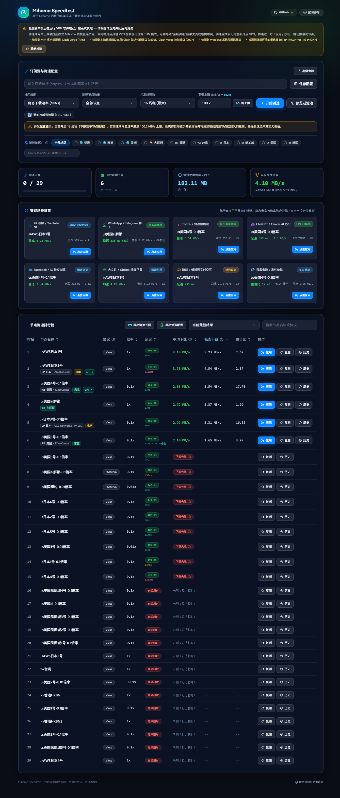

<div align="center">

# Mihomo Speedtest

**A local proxy subscription batch download speedtest tool powered by the Mihomo (Clash Meta) core**

Built-in modern **Vue 3 + Tailwind CSS + shadcn-vue** web console displaying node latency/jitter, steady download speed, IP purity, and 8 scenario-based recommendations.  
Provides both a **zero-dependency single-file Go `.exe`** and **Node.js dev/CLI** modes, supporting **one-click 2x DPI PNG leaderboard export** and clean Clash profile generation.


-0A84FF?style=flat-square)


[简体中文](README.md) | **English**

[Features](#features) · [Screenshots](#screenshots) · [Subscriptions & Protocols](#subscriptions--protocols) · [Quick Start](#1-quick-start-zero-setup) · [Development & Build](#2-requirements--commands) · [Project Structure](#3-project-structure) · [FAQ](#4-faq)

</div>

---

## Features

- **Multi-Thread Concurrency & Smart Throttle Backoff**: Supports `1 ~ 16` concurrent speedtest threads (isolated per-port workers on a single core). **Does not cap single-node peak speed**; automatically scales down threads and re-queues affected high-speed nodes when total throughput hits the configured bandwidth ceiling, and suggests scaling up when headroom is available.
- **Per-Node Multi-Stream Download**: Supports `1 ~ 8` concurrent download streams per node (default `4`), breaking past high-latency TCP BDP limits and single-stream server throttling to measure real throughput.
- **Local Bandwidth Estimation & Adaptive Sampling Protection**: Uses public or custom direct test URLs (bypassing proxies) to estimate your local downlink ceiling in ~6 seconds and fill in a recommended cap; records your local steady speed to adaptively raise the per-node sampling cap (up to `100 MB`) so high-bandwidth nodes cleanly pass the `1.5 s` slow-start warmup.
- **Real Streaming Download & Composite Quality Score (`ValueScore`)**: Multi-round latency probing computes **median latency, jitter (`±ms`), and packet loss**; scores nodes based on **steady-state download speed** (excluding the initial `1.5 s` ramp-up), multiplier, latency, jitter, and packet-loss penalties. Provides presets and Looking Glass references for public URLs including Google Chrome download link (default preset to avoid 403), Cloudflare, CacheFly, Hetzner, Linode, Leaseweb, Vultr, and OVH (custom URLs also supported), with automatic fallback if a primary link fails.
- **VPN Conflict Detection & Mainstream Client API Support**: Automatically detects active VPNs and system proxies before testing, supporting safe system-proxy cleanup, exit, and one-click restore for whitelisted open-source clients (**Clash Verge**, **Mihomo Party**, **Clash Nyanpasu**, **FlClash**, **Clash for Windows**, **v2rayN**, **NekoRay**, **NekoBox**). Advanced settings include REST API presets (`Clash Verge / Rev 9097`, `Mihomo Party / Nyanpasu / FlClash / CFW / OpenClash / ClashX 9090`), URL validation, Secret configuration, and one-click connectivity probe.
- **Exit IP Purity & Streaming/AI Unlock Probing**: Optionally inspects exit IP, geolocation/ISP, **IP type tags (Residential / Mobile / Datacenter)**, and **ChatGPT / Netflix** unlock status.
- **Region Filtering, Real-Time SSE & Exports**: Filter by continent/country with customizable keywords and a pre-test node selection pool; `300 ms` SSE live updates for throughput, traffic, and elapsed time; 8 scenario recommendations, **2x DPI PNG leaderboard export**, historical run comparison, and clean Clash YAML export (`url-test` / `fallback`).

---

## Screenshots

### Web Console Overview


### One-Click Leaderboard PNG Export (2x DPI)


---

## Subscriptions & Protocols

### 1. Subscription Sources
- **Online Subscription URL (`http://` / `https://`)**: Bypasses system proxy for direct fetching and rotates multiple `User-Agent` headers for broad provider compatibility.
- **Local Subscription File**: Accepts local file paths directly (e.g., `C:\path\to\sub.yaml` or `.txt`).

### 2. Supported Formats (4-Layer Auto-Detection)

| Format | Description |
| :--- | :--- |
| **Standard Clash / Mihomo YAML** | `.yaml` / `.yml` configs containing a `proxies` list |
| **Clash `proxy-providers` Config** | YAML configs with empty `proxies` but configured remote `proxy-providers` |
| **Base64 / URL-Safe Base64** | Common encoded subscription text used by V2Ray / Xray / Shadowrocket |
| **Plain URI List** | Line-separated URIs (`vless://`, `hy2://`, `hysteria2://`, `trojan://`, `ss://`, `ssr://`, `vmess://`, `tuic://`, `anytls://`) |

### 3. Supported Protocols
- **Supported**: `Shadowsocks (ss)`, `ShadowsocksR (ssr)`, `VMess`, `VLESS`, `Trojan`, `Hysteria`, `Hysteria2`, `TUIC`, `AnyTLS`, `WireGuard`, `SOCKS5`, `HTTP`.
- **Auto-Filtered**: Ignores non-proxy groups (`Selector`, `URLTest`, `Fallback`, `LoadBalance`, `Direct`, `Reject`, etc.) and informational nodes (e.g., traffic/expiry notices).

---

## 1. Quick Start (Zero Setup)

1. Download the latest release archive from [Releases](https://github.com/2511794726/mihomo-speedtest/releases) or build locally with `npm run pack`.
2. Extract and double-click **`mihomo-speedtest.exe`** (web assets embedded, **no Node.js or Go installation required**).
3. The app automatically finds an available port (starting from `19190`) and opens your default browser.
4. Paste your subscription URL or local file path, choose regions/test source, and click **Start Speedtest**.

### `.exe` CLI Flags (Optional)

| Flag | Default | Description |
| :--- | :--- | :--- |
| `--port=<port>` | `19190` | Starting HTTP listen port |
| `--host=<addr>` | `127.0.0.1` | Set to `0.0.0.0` to allow LAN/remote access |
| `--no-open` | `false` | Do not automatically open the browser on startup |

> **Core Note**: Release archives bundle `bin/mihomo.exe`; if missing and **Clash Verge** is installed locally, the tool automatically detects and reuses its core binary.

---

## 2. Requirements & Commands

> Not required when running the prebuilt `.exe` release. Needed only for running from source or building:

- **Node.js v18+** (Frontend build, Node backend, and test suite)
- **Go 1.22+** (Compiling the single-file `.exe` with embedded frontend)
- **PowerShell** (Running `npm run pack` on Windows)

### Common Commands

| Command | Description |
| :--- | :--- |
| `npm install && npm --prefix web install` | Install root and frontend dependencies |
| `npm start` | Launch the Node.js web UI (auto-builds frontend if missing) |
| `npm run dev` | Full-stack dev mode (Vite HMR + backend API) |
| `npm run cli` | Terminal CLI speedtest (`--sort=avg\|steady\|value`, `--limit=N`) |
| `npm run build` | Build Vue 3 frontend assets to `web/dist` |
| `npm run pack` | Build frontend, compile `.exe`, and create a versioned `.zip` release |
| `npm test` | Run Node.js unit & integration tests (`node --test`) |

---

## 3. Project Structure

```text
mihomo-speedtest/
├── main.go                    # Go entrypoint (embeds web/dist, provides HTTP/SSE API)
├── go.mod                     # Go module definition
├── package.json               # Node.js scripts and dependencies
├── internal/                  # Go backend packages
│   ├── config/                # Settings persistence and defaults
│   ├── mihomo/                # Core process lifecycle, proxy filtering & region matching
│   ├── preflight/             # Port check, VPN conflict detection, safe exit/restore
│   ├── report/                # Sorting, scenario recommendations, YAML export, history & apply
│   ├── subscribe/             # 4-layer subscription parser & multi-port runtime config builder
│   └── tester/                # Multi-stream concurrent speedtest, limiter, benchmark & unlock probe
├── web/                       # Vue 3 + Tailwind CSS v4 + shadcn-vue frontend
├── src/                       # Node.js backend, CLI, and launcher
├── scripts/release.ps1        # Windows build & zip packaging script
├── test/                      # Automated test suite (node:test)
└── docs/                      # Architecture, UI specs, and preview images
```

---

## 4. FAQ

- **Why do some nodes report "Download Failed" or "Latency Timeout"?**  
  The tool performs real streaming downloads via the Mihomo core. Nodes that time out during handshake, reset connections (`EOF`), or transfer less than `512 KB` before aborting are marked as failed; hover over the badge to inspect the exact error.
- **Is region filtering based on exit IP or node name?**  
  Region filtering matches **keywords in the node name** (case-insensitive). Click any region chip to view or customize its matching keywords.
- **Where can I find more free, reliable custom test URLs?**  
  You can copy any `100MB` test file link from official public Looking Glass pages (default 10MB cap prevents wasting traffic):
  - Vultr (30+ locations): `https://www.vultr.com/resources/looking-glass/`
  - OVHcloud (EU/NA): `https://lg.ovh.net/`
  - Hetzner (DE/FI/US): `https://fsn1-speed.hetzner.com/`, `https://ash-speed.hetzner.com/`
  - Cloudflare: `https://speed.cloudflare.com/`
  > Note: Public endpoints listed above are **for reference and on-demand single-machine diagnostics only**; availability is not guaranteed.

---

## Third-Party Components & Disclaimer

- **Intended Use**: This project is **for local network diagnostics, bandwidth evaluation, and open-source technical learning only**. It **does not bundle, provide, sell, or endorse any proxy nodes, subscription links, or cross-border network services**. Users must comply with all applicable local laws and ISP terms of service.
- **Third-Party Core (GPL-3.0)**: Speedtests rely on the `Mihomo (Clash Meta)` core, copyrighted by its authors under **GPL-3.0** ([MetaCubeX/mihomo](https://github.com/MetaCubeX/mihomo)). This MIT-licensed host application invokes the local core binary only via external subprocess and local API without statically linking its source.
- **Public Speedtest Endpoints**: Preset and Looking Glass URLs (Google Chrome download link, Cloudflare, CacheFly, Vultr, Hetzner, Linode, Leaseweb, OVH, etc.) are collected from public endpoints **for reference and on-demand diagnostics only**, with no affiliation or commercial relationship. Do not abuse public bandwidth with excessive automated load.
- **Limitation of Liability**: Users assume full responsibility for their usage; the authors and contributors bear **no legal liability** for any direct or indirect damages or compliance risks.

---

## License

Copyright © 2026 **[da wenxi](https://github.com/2511794726)**. Released under the [MIT License](LICENSE).
