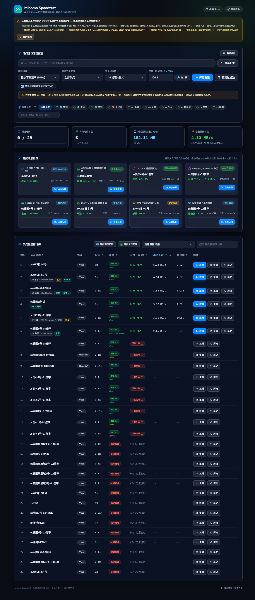

<div align="center">

# Mihomo Speedtest

**基于 Mihomo (Clash Meta) 内核的本地化代理订阅批量真实下载速率测速工具**

内置 **Vue 3 + Tailwind CSS + shadcn-vue** 现代化 Web 控制台，直观呈现节点延迟/抖动、稳态下载速率、IP 纯净度与 8 大平台场景推荐  
提供 **Go 单文件零依赖 `.exe` 开箱版** 与 **Node.js 开发 / CLI** 双运行形态，支持 **一键导出高清 PNG 测速长图** 与精简 Clash 配置


-0A84FF?style=flat-square)


[核心特性](#核心特性) · [界面预览](#界面预览) · [订阅与协议支持](#订阅与协议支持) · [快速上手](#一快速上手免环境开箱即用) · [开发与打包](#二环境要求与常用命令) · [目录结构](#三项目目录结构) · [常见问题](#四常见问题)

</div>

---

## 核心特性

- **多线程并发 + 智能防封顶退避**：支持 `1 ~ 16` 线程并发测速（单核多端口独立分流，互不干扰）。**不限制单节点极速**；当总速率触及预设宽带上限时自动降低并发线程，并将受竞争影响的高速节点放回队列重测，同时支持根据实测峰值宽带余量实时热扩容线程。
- **一键本地宽带上限压测**：内置 8 路并发多源大厂 CDN 直连压测（绕过代理），6 秒测出本地网络真实物理上限，一键填入推荐上限（开启多线程测速前需设置宽带上限）。
- **VPN 冲突检测与白名单安全退/启**：测速前自动检测运行中的 VPN 与系统代理；针对白名单开源客户端（Clash Verge、Mihomo Party、Clash Nyanpasu、Clash for Windows、v2rayN、NekoRay）支持**先关系统代理防断网并安全退出**，测速完成后弹窗提示一键按原路径重新打开。
- **真实流式下载测速与双阶段熔断**：多轮延迟采样计算**中位数延迟、抖动（`±ms`）与丢包率**；支持单节点流量熔断上限（默认 `10 MB`）与下载超时（默认 `8 s`）双熔断，统计剔除前 `1.5 s` 慢启动的**稳态下载速率**；内置 Cloudflare / Google / Microsoft / Telegram / CacheFly / Hetzner 等大厂测速源，主源遇盾或失败时自动切换备用源兜底。
- **出口 IP 纯净度与流媒体/AI 解锁探测**：支持对可用节点额外探测出口真实 IP、归属地/ISP 运营商、**IP 类型标注（原生家宽 / 移动 / 机房 IDC）**，以及 **ChatGPT / Netflix** 解锁情况。
- **精确地区筛选与预览过滤池**：支持按大洲 / 国家精确匹配节点并自定义关键字；支持测速前「预览过滤池」并自由勾选局部节点测试，支持单节点快速复测。
- **8 大平台场景推荐、PNG 长图导出与精简配置**：自动为 **4K 视频 (YouTube/NF)**、**WhatsApp / Telegram 聊天**、**TikTok 短视频**、**ChatGPT / Claude AI 办公**、**Facebook / IG 社交**、**大文件/GitHub 下载**、**游戏低延迟**、**日常省流高性价比** 推荐最优节点；支持**一键生成排行榜测速长图（2x DPI PNG，支持预览、复制与下载）**、历次测速对比、**一键应用到主流代理客户端**，以及导出含 `url-test` / `fallback` 策略组的精简 Clash 优选配置。

---

## 界面预览



---

## 订阅与协议支持

### 1. 订阅来源
- **在线订阅 URL（`http://` / `https://`）**：自动禁用系统代理直连拉取，并按顺序轮询多种 `User-Agent`（兼容 Clash、Mihomo、Clash Verge、Shadowrocket 等各类机场下发策略）。
- **本地订阅文件**：支持直接输入本地文件路径（如 `C:\path\to\sub.yaml` 或 `.txt`）。

### 2. 订阅内容格式（四层自动嗅探）

| 订阅格式 | 说明 |
| :--- | :--- |
| **标准 Clash / Mihomo YAML** | 包含 `proxies` 列表的 `.yaml` / `.yml` 配置 |
| **Clash `proxy-providers` 配置** | `proxies` 为空但配置了远程 `proxy-providers` 节点集的 YAML |
| **Base64 / URL-Safe Base64 订阅** | 常见于 V2Ray / Xray / Shadowrocket 的通用加密文本订阅 |
| **明文 URI 节点列表** | 直接由 `vless://`、`hy2://`、`hysteria2://`、`trojan://`、`ss://`、`ssr://`、`vmess://`、`tuic://`、`anytls://` 组成的逐行文本 |

### 3. 支持测速的节点协议
- **支持协议**：`Shadowsocks (ss)`、`ShadowsocksR (ssr)`、`VMess`、`VLESS`、`Trojan`、`Hysteria`、`Hysteria2`、`TUIC`、`AnyTLS`、`WireGuard`、`SOCKS5`、`HTTP`。
- **自动过滤**：自动忽略非测速策略组（`Selector`、`URLTest`、`Fallback`、`LoadBalance`、`Direct`、`Reject` 等）及状态提示节点（如“剩余流量”、“套餐到期”等）。

---

## 一、快速上手（免环境开箱即用）

1. 从 [Releases](https://github.com/2511794726/mihomo-speedtest/releases) 下载或通过 `npm run pack` 生成发布压缩包 `release/mihomo-speedtest-v<版本>-<时间>.zip`。
2. 解压后直接双击 **`mihomo-speedtest.exe`**（内置前端界面，**无需安装 Node.js 或 Go**）。
3. 程序会自动探测可用端口（默认 `19190` 起，若被占用自动顺延）并打开默认浏览器。
4. 在页面顶部填入订阅链接或本地订阅路径，按需选择测速地区与下载源，点击「开始测速」即可。

### `.exe` 启动参数（可选）

| 参数 | 默认值 | 说明 |
| :--- | :--- | :--- |
| `--port=<端口>` | `19190` | 指定起始 HTTP 监听端口 |
| `--host=<地址>` | `127.0.0.1` | 设为 `0.0.0.0` 可允许局域网或服务器外部访问 |
| `--no-open` | `false` | 启动时不自动打开浏览器 |

> **内核说明**：发布包内置 `bin/mihomo.exe`；若目录中不存在且本机已安装 **Clash Verge**，程序会自动探测并复用其内置内核。

### 界面使用说明

1. **配置订阅与宽带上限**：在顶部输入框粘贴在线订阅链接或本地订阅文件路径；点击「测上限」可 6 秒测出本地网络真实物理上限并一键填入（设置宽带上限后即可开启 `2 ~ 16` 线程并发测速）。
2. **筛选目标节点与预览**：
   - **按地区/大洲筛选**：勾选「全部地区」或指定大洲/国家（仅通过节点名称关键字匹配）；**点击地区名称**可查看并自定义该地区的匹配关键字。
   - **预览过滤池与高级筛选**：可在「排除关键字」或「自定义包含词」中进一步过滤，并点击「预览过滤池」自由勾选局部节点测速。
3. **开始测速与实时调优**：
   - 若本机正在运行白名单 VPN 软件，点击「开始测速」时会提示安全退出并在测完后恢复。
   - 测速过程中实时展示消耗流量、耗时、瞬时速率与峰值速率；若宽带余量充足会弹出热扩容建议，若总速率触顶则自动降线程并重测受影响节点。
4. **结果应用、复测与导出**：
   - 测速结束后展示八大平台/场景智能推荐；榜单支持单节点「复测」、「历史」对比、节点名称一键复制、**一键生成高清 PNG 测速长图**，以及导出精简 Clash 优选 YAML。
   - 点击「应用」可选择 **Clash Verge / Mihomo Party / Clash Nyanpasu / Clash for Windows / v2rayN** 等客户端，一键将最优节点切换至目标代理组。

---

## 二、环境要求与常用命令

> 仅下载 `.exe` 发布包直接运行**无需以下环境**；如需从源码运行、二次开发或自行打包，请准备以下环境：

- **Node.js v18+**（前端构建、Node 版后端与测试套件）
- **Go 1.22+**（编译内嵌前端的单文件 `.exe`）
- **PowerShell**（Windows 下执行 `npm run pack` 打包脚本）

### 常用命令

| 命令 | 说明 |
| :--- | :--- |
| `npm install && npm --prefix web install` | 首次安装根目录与前端依赖 |
| `npm start` | 启动 Node.js 版图形界面并自动打开浏览器（缺构建产物时自动构建） |
| `npm run dev` | 前后端联合开发模式（Vite 热更新 + 后端 API，自动避让占用端口） |
| `npm run cli` | 纯命令行终端测速（支持 `--sort=avg\|steady\|value`、`--limit=N`） |
| `npm run build` | 单独构建 Vue 3 前端静态资源至 `web/dist` |
| `npm run pack` | 一键构建前端、编译 `.exe` 并生成带版本号与时间戳的 `.zip` 发布包 |
| `npm test` | 运行全部自动化单元测试与集成测试（`node --test`） |
| `启动测速面板.bat` | Windows 一键批处理启动脚本（自动检查并引导安装 Node.js 与依赖） |

---

## 三、项目目录结构

```text
mihomo-speedtest/
├── main.go                    # Go 单文件主程序（embed 内嵌 web/dist，提供 HTTP/SSE API）
├── go.mod                     # Go 模块与依赖声明
├── package.json               # Node.js 脚本与依赖配置
├── internal/                  # Go 后端核心模块
│   ├── config/                # 配置读写与默认测速源/关键字配置
│   ├── mihomo/                # 内核进程管理、节点过滤与地区关键字匹配
│   ├── preflight/             # 端口探测、VPN 冲突检测、白名单安全退/启与内核复用
│   ├── report/                # 榜单排序、场景推荐、精简 YAML 导出、历史留痕与多客户端应用
│   ├── subscribe/             # 四层订阅嗅探、多 UA 拉取与多端口并发分流配置生成
│   └── tester/                # 多线程并发测速、防封顶退避重测、本地宽带压测与 IP/解锁探测
├── web/                       # Vue 3 + Tailwind CSS v4 + shadcn-vue 前端工程
├── src/                       # Node.js 版后端服务、CLI 与启动器
├── scripts/release.ps1        # 一键构建与 .zip 打包脚本
├── test/                      # 自动化测试套件 (node:test)
├── docs/                      # 架构、测试指南与前端 UI 规范文档
├── bin/                       # Mihomo 内核目录
├── configs/                   # 订阅缓存与运行时清洗配置（.gitignore 忽略）
├── results/                   # 测速结果与 history/ 历史留痕（.gitignore 忽略）
└── release/                   # 打包输出的发布目录与 .zip 压缩包（.gitignore 忽略）
```

---

## 四、常见问题

- **为什么部分节点显示「下载失败」或「延迟超时」？**  
  本工具通过 Mihomo 内核发起真实流式下载测速，若节点握手超时、连接被重置（`EOF`）或中断前下载不足 `512 KB`，将记为失败；鼠标悬停在「下载失败」徽标上可查看完整错误原因。
- **地区筛选是按真实 IP 还是节点名称？**  
  地区筛选**仅通过节点名称中的关键字匹配**（不区分大小写）。点击地区标签名称即可自定义或恢复默认匹配关键字。
- **为什么打包时杀毒软件拦截 `bin/mihomo.exe`？**  
  部分安全软件会对代理内核报误报。若本机已安装 Clash Verge，可直接将其目录加入信任区，或直接复用 Clash Verge 内置内核运行。

---

## 免责声明

- 本项目**仅用于学习、研究与个人网络性能测试交流**，请勿用于任何违反当地法律法规或服务条款的用途。
- 使用者应自行对其使用行为及后果负责；因使用、修改或传播本项目所产生的任何直接或间接后果，**项目作者及贡献者均不承担任何法律责任**。

---

## 版权与协议

Copyright © 2026 **[da wenxi](https://github.com/2511794726)**. 本项目基于 [MIT License](LICENSE) 开源。
